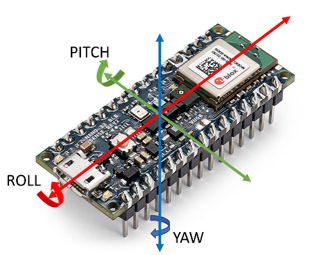
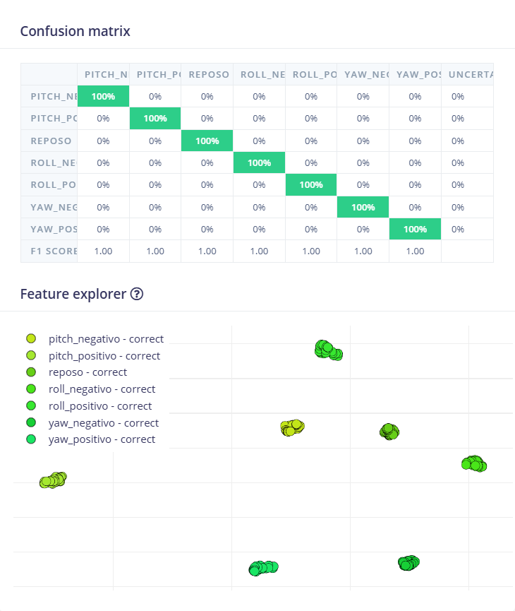

# 🧭 Real-Time 3D Orientation Classification using TinyML & Edge Impulse

[](https://docs.arduino.cc/hardware/nano-33-ble-sense)
[](https://edgeimpulse.com/)
[](https://isocpp.org/)
[](https://eina.unizar.es/)

## 🎓 Academic Context

* **Institution:** School of Engineering and Architecture (**EINA**) — **University of Zaragoza (UNIZAR)**
* **Program:** Master's Degree in Electronic Engineering (*Máster Universitario en Ingeniería Electrónica*)
* **Course:** Intelligent Sensors (*Sensores Inteligentes*)

---

## 📋 Table of Contents

1. [Project Overview](#-project-overview)
2. [Hardware & Orientation Reference](#-hardware--orientation-reference)
3. [State-to-LED Color Mapping](#-state-to-led-color-mapping)
4. [Edge Impulse Pipeline & DSP Analysis](#-edge-impulse-pipeline--dsp-analysis)
   - [Why Raw Data Outperformed Spectral Analysis (FFT & Wavelet)](#-why-raw-data-outperformed-spectral-analysis-fft--wavelet)
5. [Model Performance & Evaluation](#-model-performance--evaluation)
6. [Embedded Firmware Architecture](#-embedded-firmware-architecture)
7. [Repository Structure & Deployment](#-repository-structure--deployment)

---

## 🎯 Project Overview

This project implements an end-to-end **TinyML** edge inference system capable of recognizing seven distinct 3D spatial orientations and rotational states of an **Arduino Nano 33 BLE Sense** microcontroller in real time.

Using 6-axis Inertial Measurement Unit (**IMU**) sensor fusion (3-axis accelerometer + 3-axis gyroscope) and a neural network classifier trained in **Edge Impulse**, the microcontroller classifies its current orientation/motion on-device and provides immediate visual feedback by driving its onboard RGB LED with a distinct color for each state.

---

## 🔧 Hardware & Orientation Reference

* **Microcontroller:** Arduino Nano 33 BLE Sense (nRF52840 ARM Cortex-M4F @ 64 MHz)
* **Inertial Sensor:** Onboard 9-axis IMU (`Arduino_LSM9DS1` library — utilizing Accelerometer & Gyroscope)
* **Actuator:** Onboard common-anode RGB LED (`LEDR`, `LEDG`, `LEDB` pins)

The coordinate system and rotational axes (**Roll**, **Pitch**, and **Yaw**) follow the physical reference frame of the board shown below:

<p align="center">
  
</p>

---

## 🎨 State-to-LED Color Mapping

The classifier distinguishes **7 classes** (`roll_positivo`, `roll_negativo`, `pitch_positivo`, `pitch_negativo`, `yaw_positivo`, `yaw_negativo`, and `reposo`). Because the Arduino Nano 33 BLE Sense integrates a **common-anode (active-low)** RGB LED, PWM duty cycles are inverted in firmware (`255 - value`) so that `0` corresponds to maximum brightness and `255` turns the channel off.

| Edge Impulse Label | Physical Orientation / State | LED Color | Standard RGB `(R, G, B)` | Active-Low PWM `(LEDR, LEDG, LEDB)` |
| :--- | :--- | :---: | :---: | :---: |
| `roll_positivo` | Positive Roll rotation | 🔴 **Red** | `(255, 0, 0)` | `(0, 255, 255)` |
| `roll_negativo` | Negative Roll rotation | 🩷 **Pink** | `(255, 30, 90)` | `(0, 225, 165)` |
| `pitch_positivo` | Positive Pitch tilt | 🟢 **Green** | `(0, 255, 0)` | `(255, 0, 255)` |
| `pitch_negativo` | Negative Pitch tilt | 🟡 **Yellow** | `(255, 160, 0)` | `(0, 95, 255)` |
| `yaw_positivo` | Positive Yaw rotation | 🔵 **Blue** | `(0, 0, 255)` | `(255, 255, 0)` |
| `yaw_negativo` | Negative Yaw rotation | 🟣 **Purple** | `(120, 0, 255)` | `(135, 255, 0)` |
| `reposo` | Resting / Neutral position (or `< 60%` confidence) | ⚫ **Off** | `(0, 0, 0)` | `(255, 255, 255)` |

---

## 🧠 Edge Impulse Pipeline & DSP Analysis

### Impulse Architecture

The Edge Impulse pipeline (**Impulse #1**) was designed using **6-axis Sensor Fusion** combining linear acceleration and angular velocity:

<p align="center">
  
</p>

* **Time Series Data Input:**
  * **Input Axes (6):** `accX`, `accY`, `accZ` ($\text{m/s}^2$) and `gyrX`, `gyrY`, `gyrZ` ($\text{deg/s}$)
  * **Window Size:** `1,000 ms` (100 samples per axis per window)
  * **Window Increase (Stride):** `200 ms`
  * **Sampling Frequency:** `100 Hz`
  * **Zero-pad Data:** Enabled
* **Processing Block:** **Raw Data** (600 raw features per window: $100 \text{ samples} \times 6 \text{ axes}$)
* **Learning Block:** **Classification (Neural Network)** outputting probabilities across the 7 target labels.

### 🔬 Why Raw Data Outperformed Spectral Analysis (FFT & Wavelet)

During experimentation, **Spectral Analysis** DSP blocks were tested using both **Fast Fourier Transform (FFT)** and **Wavelet Transform** configurations prior to selecting the **Raw Data** block. Both spectral approaches yielded noticeably lower classification accuracy than feeding raw time-domain signals directly into the classifier due to the physical nature of the problem:

1. **Loss of Static Gravity Polarity (DC Component):** Spectral Analysis is specifically designed to extract frequency-domain power characteristics from *repetitive or periodic motions* (such as vibration analysis or gesture shaking). However, static inclinations (`Pitch` and `Roll`) rely primarily on the DC projection of Earth's gravity ($g \approx 9.81\text{ m/s}^2$) across the accelerometer axes. High-pass filtering and spectral magnitude transformations strip away or obscure the DC offset and sign polarity needed to distinguish positive from negative tilt angles.
2. **Directional Sign Erasure in Gyroscope Pulses:** Distinguishing `yaw_positivo` from `yaw_negativo` (and directional roll/pitch transitions) depends directly on the **sign** ($+$ or $-$) of the angular velocity peaks measured by the gyroscope (`gyrX`, `gyrY`, `gyrZ`). Magnitude-based spectral representations discard phase/sign information, causing opposite rotational directions to produce nearly identical spectral signatures.
3. **Time-Domain Preservation:** By using the **Raw Data** processing block, the neural network directly observes both the exact signed gravity vector components and the signed temporal evolution of angular velocity across the `1,000 ms` window, eliminating spectral ambiguity.

---

## 📊 Model Performance & Evaluation

The trained model achieved **100% accuracy** and a **1.00 F1-score** across all seven classes on the validation dataset, with `0%` misclassification and `0%` uncertain predictions:

<p align="center">
  
</p>

* **Confusion Matrix:** Every class (`PITCH_NEGATIVO`, `PITCH_POSITIVO`, `REPOSO`, `ROLL_NEGATIVO`, `ROLL_POSITIVO`, `YAW_NEGATIVO`, `YAW_POSITIVO`) achieved **100%** true positive rate.
* **Feature Explorer:** Dimensionality reduction visualization confirms tight intra-class clustering and wide inter-class separation across all seven states.

---

## 💻 Embedded Firmware Architecture

The Arduino sketch (`clasificador_IMU/clasificador_IMU.ino`) adapts the Edge Impulse C++ SDK inference loop for real-time 6-axis sensor fusion and PWM LED control:

* **Sensor Fusion Interleaving:** Reads `IMU.readAcceleration()` (clamped to `±2.0 G` and scaled by `9.80665f` to $\text{m/s}^2$) and `IMU.readGyroscope()` ($\text{deg/s}$) at `100 Hz`, packing them in the exact `[accX, accY, accZ, gyrX, gyrY, gyrZ]` order expected by `EI_CLASSIFIER_SENSOR_FUSION`.
* **Confidence Thresholding:** Applies a `CONFIDENCE_THRESHOLD` of `0.90f` (90%). If the highest predicted probability falls below this threshold during rapid transitions, the LED turns off cleanly to prevent flickering.
* **Non-Blocking Serial Startup:** `while (!Serial);` is disabled so the board operates autonomously when powered via external USB/battery without requiring an active Serial Monitor connection.
* **Fast Inference Cadence:** Uses a `200 ms` delay between sampling windows for responsive visual feedback.

---

## 🚀 Repository Structure & Deployment

### Folder Structure

```text
Practica_2_SENS_INTELIGENTES/
├── clasificador_IMU/
│   └── clasificador_IMU.ino      # Main Arduino sketch for 6-axis inference & RGB LED control
├── images/
│   ├── axes_reference.png        # Roll, Pitch, and Yaw axis diagram
│   ├── impulse_design.png        # Edge Impulse Studio Impulse #1 block diagram
│   └── confusion_matrix.png      # Validation Confusion Matrix & Feature Explorer
└── README.md                     # Project documentation
```

### How to Build & Flash

1. **Export the Edge Impulse Library:**
   * In Edge Impulse Studio, navigate to **Deployment** $\rightarrow$ **Arduino library** and build/download the `.zip` library (`ei-clasificacion_imu-arduino-*.zip`).
2. **Install Dependencies in Arduino IDE:**
   * Go to **Sketch** $\rightarrow$ **Include Library** $\rightarrow$ **Add .ZIP Library...** and select the downloaded Edge Impulse library.
   * Open **Tools** $\rightarrow$ **Manage Libraries...** and install **`Arduino_LSM9DS1`** (or the corresponding IMU library for your board revision).
3. **Configure Board & Upload:**
   * Select **Tools** $\rightarrow$ **Board** $\rightarrow$ **Arduino Mbed OS Nano Boards** $\rightarrow$ **Arduino Nano 33 BLE**.
   * Open `clasificador_IMU/clasificador_IMU.ino`, click **Verify**, and **Upload** to the board.
   * *(Optional)* Open the **Serial Monitor** at `115200 baud` to inspect real-time DSP/classification latency and per-class confidence scores.
